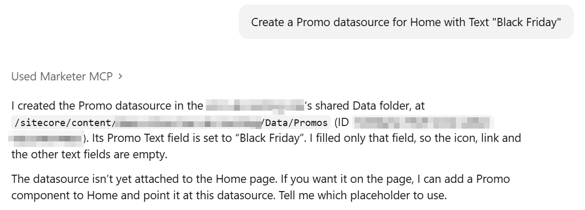
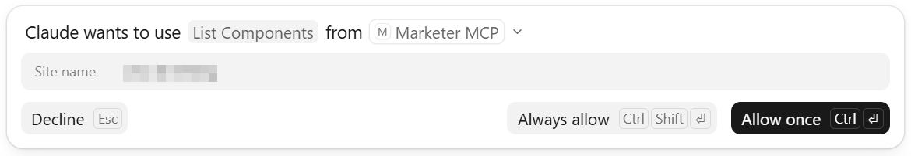
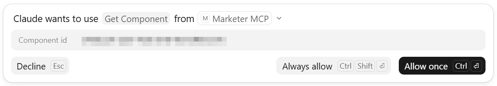
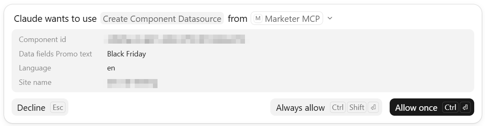
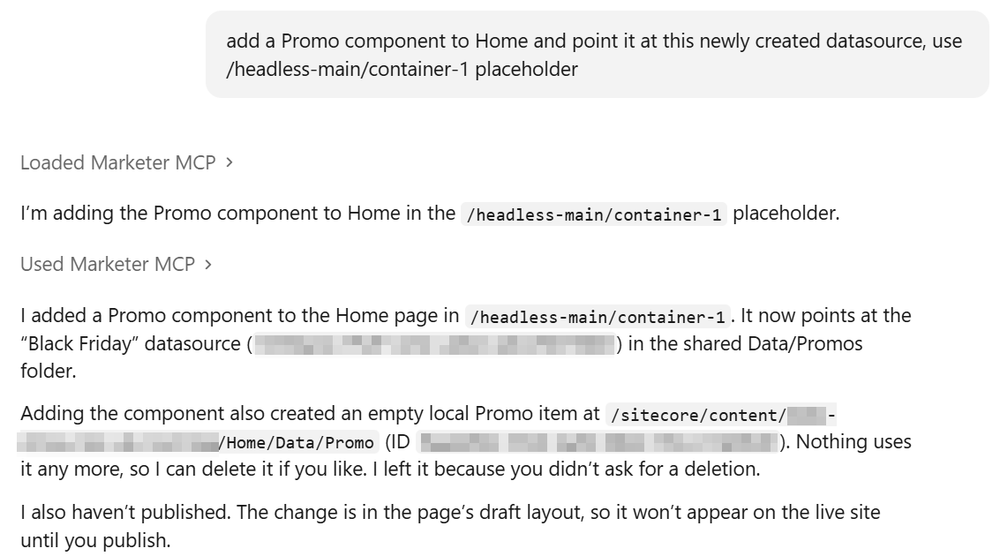
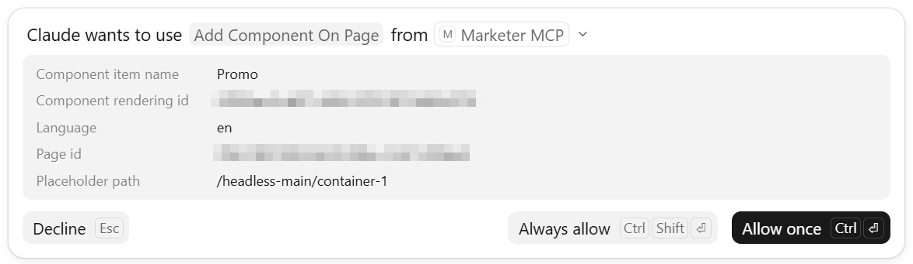
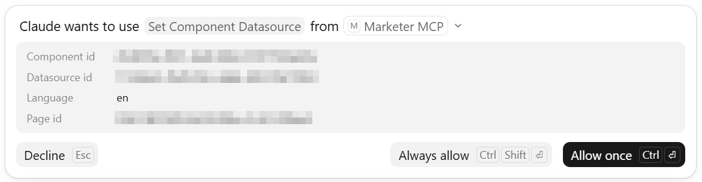

# Create a new datasource item

## Prompt
To create a new datasource item for a specific component, use the following prompt. Replace the component name and field values as required:
```
Create a Promo datasource for Home with Text "Black Friday"
```

## Output
Here is a response from Claude after creating the datasource item:


While Claude processes your request it may ask for permission to use the `List Components` and `Get Component` tools to retrieve information about the requested component including its ID and datasource configuration. You will see the following notifications:




After validating that the requested component exists and retrieving its datasource configuration, Claude will proceed with creating the datasource item using the provided field values. It will then ask for permission to use the `Create Component Datasource` tool:




# Add a component and set its datasource
Once the datasource item has been created it can be assigned to a component on a page.

## Prompt
To add a Promo component to one of the existing pages and assign the newly created datasource to it use the following prompt:
```
add a Promo component to Home and point it at this newly created datasource, use /headless-main/container-1 placeholder
```

## Output
Here is a response from Claude after adding the component to the page and assigning its datasource:


While Claude processes your request it may ask for permission to use the `Add Component On Page` and `Set Component Datasource` tools to add the required component to a specific placeholder on the selected page and assign the datasource to it. You will see the following notifications:





