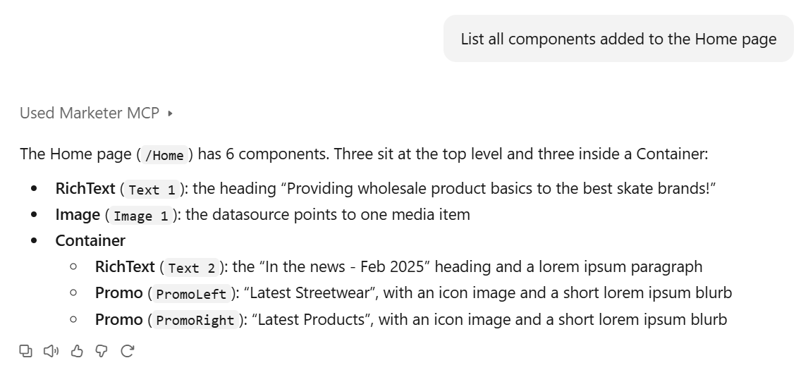

# List Components

## Prompt
To identify the components already placed on a specific page, use the following prompt and replace the page name as needed:
```
List all components added to the Home page
```

## Output
Here is a response from Claude:

