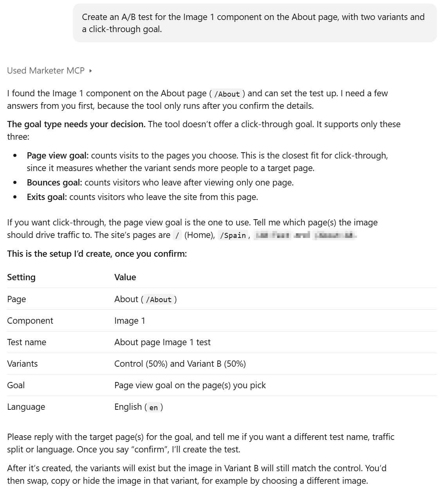
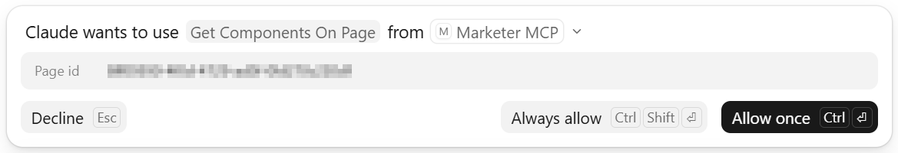
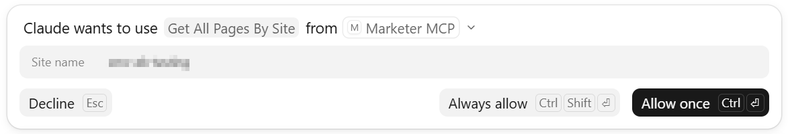
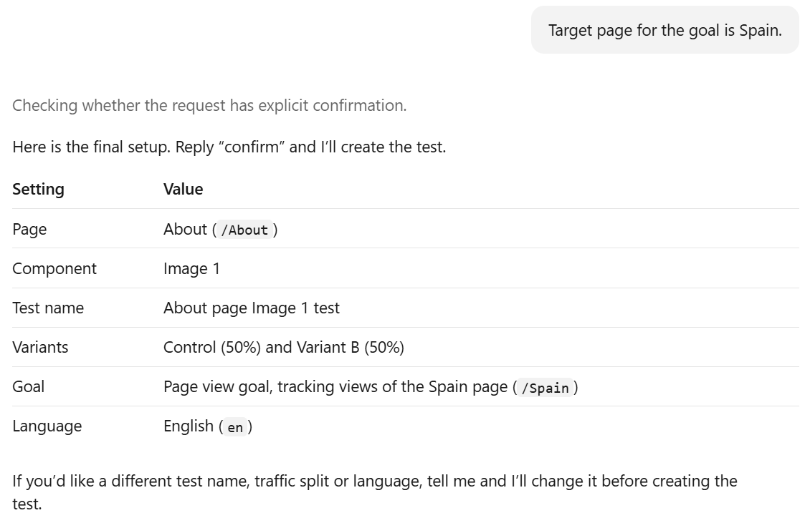
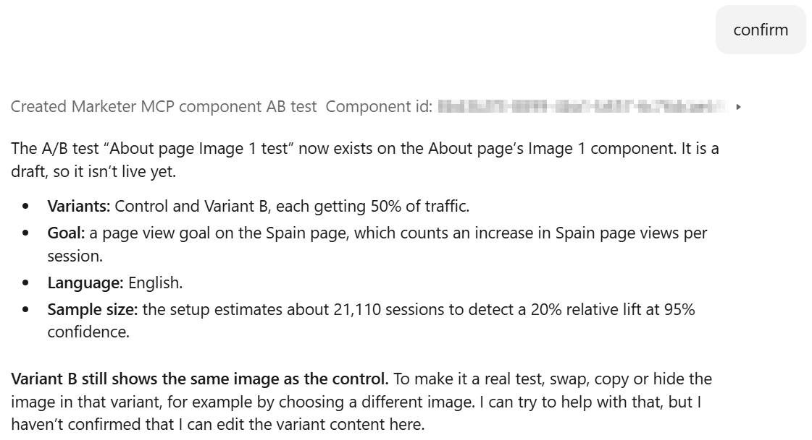
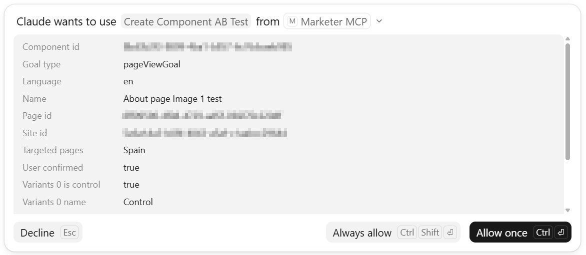
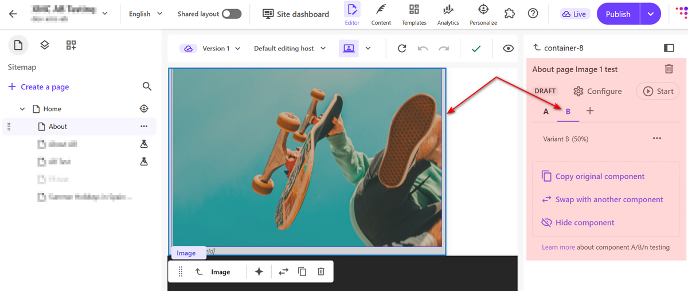

# Create an A/B/n test for a component

## Prompt
To create a component specific A/B/n test on a given page, use the following prompt and replace the page and component names as needed:
```
Create an A/B test for the Image 1 component on the About page, with two variants and a click-through goal.
```

## Output
Here is a response from Claude:


While Claude processes your request it may request permission to use the `Get Components On Page` and `Get All Pages By Site` tools. These tools allow Claude to locate the target component on the specified page and also remind you of the pages available for a page view goal. You will see the following notifications:





Next, specify the goal you want to create. For a page view goal, select the target page and adjust the test name, traffic split or language as needed.



Finally, say "confirm" to trigger the test creation:


Claude will then request permission to use the `Create Component AB Test` tool, you will see the below notification:



Once the process is complete, the newly created variant will match the original component. You can now modify it as you wish, for example, by choosing a different image or hiding it. The result will appear in the Page Builder as shown below:


