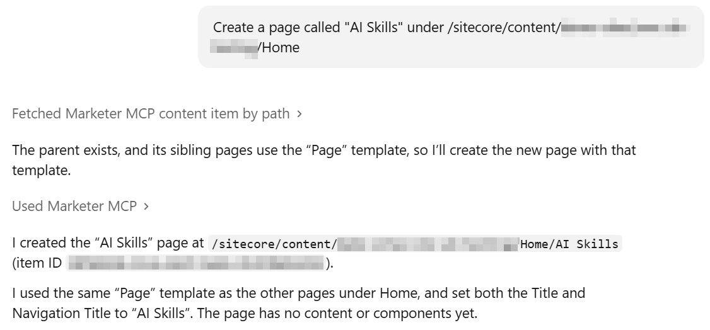
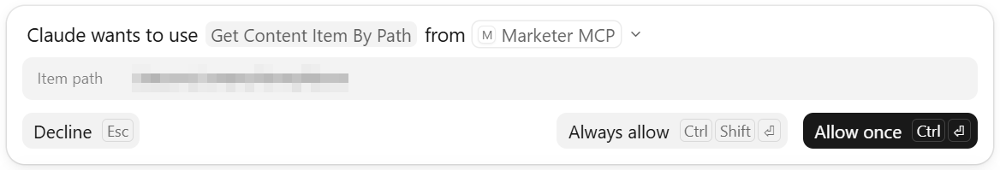
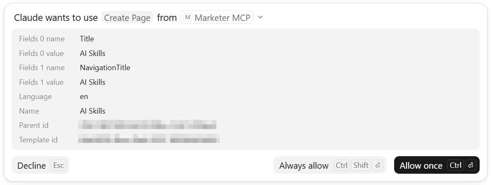

# Create a new page

## Prompt
To create a new page, use the following prompt. Replace the page name and parent page path with the appropriate values for your content structure:
```
Create a page called "AI Skills" under /sitecore/content/Home/About
```

## Output
Here is a response from Claude after creating the page:


While Claude processes your request it may ask for permission to use the `Get Content Item By Path` tool to retrieve information about the parent content item. You will see the following notification:



If the parent page exists, Claude can use information about its sibling pages to determine the appropriate page template for the new page. Before creating the page, you will be asked to grant permission to use the `Create Page` tool:




